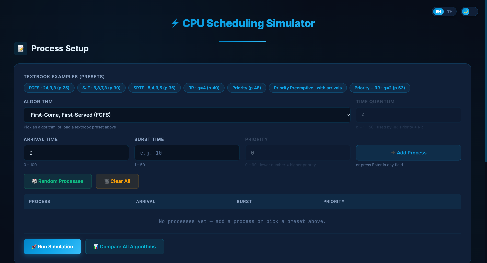
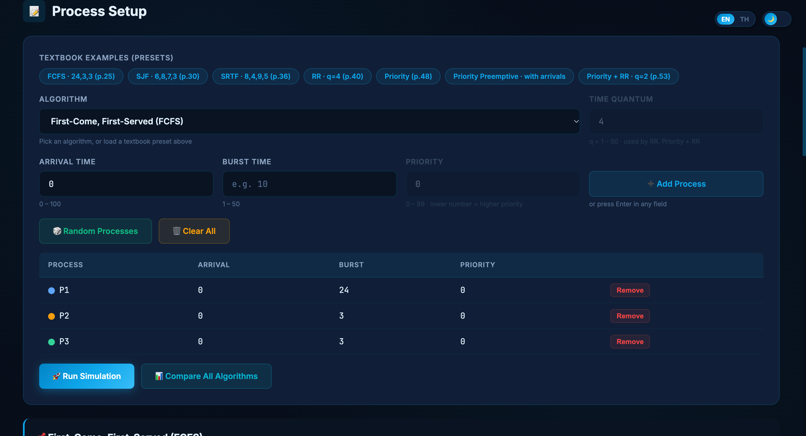
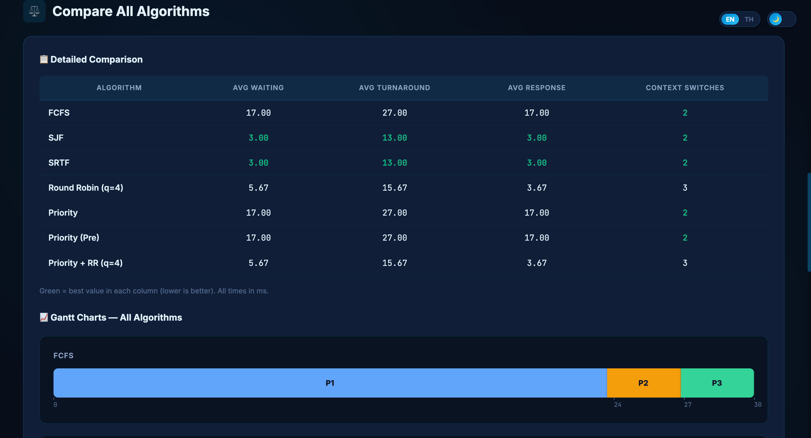

# ⚡ CPU Scheduling Simulator — Presentation Deck & Script (10 Mins / 5 Speakers)

> **Course:** 03603332 Operating Systems (Chapter 4: CPU Scheduling)  
> **Instructor:** Prasitthichai Naronglerdrit, Dept. of Computer Engineering, KU Sriracha  
> **Total Time:** 10 Minutes (~2 minutes per speaker)  
> **Format:** Slide presentation + Live interactive web demo  

---

## 👥 Speaker Roles & Time Allocation Overview

| Speaker | Time | Section | Topic & Key Demo Action |
| :--- | :---: | :--- | :--- |
| **Speaker 1** | 0:00 – 2:00 | Intro & Foundation | Slide 1 & 2: Project overview, CPU scheduling goals, CPU-I/O burst cycle. |
| **Speaker 2** | 2:00 – 4:00 | Algorithms & Setup | Slide 3 & 4: Supported algorithms (FCFS, SJF, RR, Priority), Presets & Random generator. |
| **Speaker 3** | 4:00 – 6:00 | **Live Demo Part 1** | Slide 5 & 6: Interactive pipeline (Ready/Running/Completed), Gantt chart & Per-process timeline. |
| **Speaker 4** | 6:00 – 8:00 | **Live Demo Part 2** | Slide 7 & 8: Performance metrics (Waiting, Turnaround, Response) & Compare All showdown. |
| **Speaker 5** | 8:00 – 10:00 | Analysis & Conclusion | Slide 9 & 10: OS trade-offs (Time quantum, Convoy effect, Starvation/Aging), Summary & Q&A. |

---

## 🎤 Detailed Slide Content & Bilingual Speaking Scripts

---

### 👤 SPEAKER 1 (0:00 – 2:00): Introduction & Problem Statement

#### Slide 1: Title Slide & Team Introduction
* **Slide Title:** Interactive CPU Scheduling Simulator
* **Subtitle:** Operating System Concepts (Chapter 4) · Department of Computer Engineering, KU Sriracha
* **Visual:** Project logo / Header snapshot

* **Bullet Points on Slide:**
  * Interactive web simulator for CPU scheduling algorithms
  * Real-time Ready Queue pipeline & animated Gantt chart
  * Direct reproduction of Silberschatz textbook examples
  * Team members: [Member 1, Member 2, Member 3, Member 4, Member 5]

---

**🗣️ Speaker 1 Script (English):**
> *"Good morning, Professor and everyone. Today, our team is excited to present our web application: the **CPU Scheduling Simulator**.*  
> *In any computer system, the CPU is the brain. However, in a single-core system, only one process can execute at any given moment. Our goal was to create an interactive learning tool that makes abstract operating system concepts visual, tangible, and easy to understand."*

**🇹🇭 คำแปลภาษาไทย (สำหรับตรวจสอบความหมาย):**
> *"สวัสดีอาจารย์และเพื่อนๆ ทุกคนครับ/ค่ะ วันนี้กลุ่มของพวกเรายินดีอย่างยิ่งที่จะมานำเสนอเว็บแอปพลิเคชัน: **CPU Scheduling Simulator** ครับ*  
> *ในระบบคอมพิวเตอร์ CPU ถือเป็นสมองหลัก แต่ในระบบแบบ single-core จะมี process รันได้เพียงแค่ตัวเดียวในแต่ละขณะเท่านั้น เป้าหมายของพวกเราคือการสร้างเครื่องมือช่วยเรียนรู้แบบโต้ตอบ ที่เปลี่ยนแนวคิดนามธรรมของระบบปฏิบัติการ ให้มองเห็นเป็นภาพชัดเจนและเข้าใจง่ายครับ"*

---

#### Slide 2: Why CPU Scheduling Matters (Core Concepts)
* **Slide Title:** Why CPU Scheduling? (The Multiprogramming Goal)
* **Key Points on Slide:**
  * **Multiprogramming Goal:** Keep the CPU as busy as possible (maximize CPU utilization).
  * **CPU-I/O Burst Cycle:** Processes alternate between computing (CPU burst) and waiting for I/O.
  * **The Problem:** If a process waits for I/O and the CPU sits idle, CPU time is wasted.
  * **The Solution:** The CPU Scheduler selects another ready process to execute immediately.

**🗣️ Speaker 1 Script (English):**
> *"Why do we need CPU scheduling? Real programs don't just compute; they alternate between CPU calculation and waiting for I/O devices. This is known as the **CPU-I/O burst cycle**.*  
> *Without scheduling, whenever a program waits for a file or network response, the CPU sits idle and wastes valuable processing time. Through **multiprogramming**, the OS picks another ready process from memory, maximizing CPU utilization.  
> *Next, Speaker 2 will explain the algorithms and features implemented in our simulator."*

**🇹🇭 คำแปลภาษาไทย (สำหรับตรวจสอบความหมาย):**
> *"ทำไมเราถึงต้องมี CPU Scheduling? เพราะโปรแกรมจริงไม่ได้คำนวณตลอดเวลา แต่จะสลับกันระหว่างการคำนวณบน CPU และการรออุปกรณ์ I/O ซึ่งเรียกว่า **CPU-I/O burst cycle** ครับ*  
> *ถ้าไม่มีการจัดคิว เมื่อใดก็ตามที่โปรแกรมรอไฟล์หรือรอเครือข่าย CPU ก็จะว่างเปล่าและเสียเวลาไปโดยเปล่าประโยชน์ ด้วยเทคนิค **Multiprogramming** ระบบปฏิบัติการจึงต้องเลือก process อื่นที่พร้อมทำงานขึ้นมารันต่อทันทีเพื่อใช้ CPU ให้คุ้มค่าที่สุด  
> *ในลำดับถัดไป ผู้พูดคนที่ 2 จะมาอธิบายถึงอัลกอริทึมและฟีเจอร์ต่างๆ ในโปรแกรมจำลองของเราครับ"*

---

### 👤 SPEAKER 2 (2:00 – 4:00): Algorithms & Process Input System

#### Slide 3: Supported Scheduling Algorithms
* **Slide Title:** Supported CPU Scheduling Algorithms
* **Key Points on Slide:**
  * **Non-preemptive:**
    * **FCFS (First-Come, First-Served):** Simplest, FIFO order, suffers from *Convoy Effect*.
    * **SJF (Shortest-Job-First):** Optimal average waiting time, selects shortest CPU burst.
    * **Priority:** Selects process with highest priority (lower number = higher priority).
  * **Preemptive:**
    * **SRTF (Shortest-Remaining-Time-First):** Preempts if a new process has shorter remaining time.
    * **Round Robin (RR):** Time-sliced execution with time quantum $q$; fair and responsive.
    * **Priority Preemptive & Priority + RR:** Combines priority levels with Round Robin time-slicing.

**🗣️ Speaker 2 Script (English):**
> *"Thank you, Speaker 1. Our simulator implements six major CPU scheduling algorithms from Chapter 4.*  
> *We categorize them into two main types: **Non-preemptive** and **Preemptive**.*  
> *In Non-preemptive algorithms like **FCFS** and standard **SJF**, once a process gets the CPU, it holds it until completion.*  
> *In Preemptive algorithms like **SRTF** and **Round Robin**, the operating system can interrupt a running process if a shorter job arrives or when its **time quantum** expires. We also support **Priority Scheduling** and a hybrid **Priority plus Round Robin**."*

**🇹🇭 คำแปลภาษาไทย (สำหรับตรวจสอบความหมาย):**
> *"ขอบคุณผู้พูดคนที่ 1 ครับ โปรแกรมจำลองของเรารองรับ 6 อัลกอริทึมหลักตามบทเรียนบทที่ 4 ครับ*  
> *เราสามารถแบ่งออกเป็น 2 ประเภทหลัก ได้แก่ **Non-preemptive** (ไม่แย่งชิง) และ **Preemptive** (แย่งชิงได้)*  
> *สำหรับแบบ Non-preemptive เช่น **FCFS** และ **SJF ปกติ** เมื่อ process ได้ CPU ไปแล้ว จะรันจนกว่าจะจบงาน*  
> *ส่วนแบบ Preemptive เช่น **SRTF** และ **Round Robin** ระบบปฏิบัติการสามารถขัดจังหวะ process ที่กำลังรันอยู่ได้ หากมี process ที่งานสั้นกว่าเข้ามา หรือเมื่อหมดช่วงเวลา **Time Quantum** นอกจากนี้เรายังรองรับ **Priority** และระบบผสมอย่าง **Priority + Round Robin** อีกด้วยครับ"*

---

#### Slide 4: Flexible Process Setup & Textbook Presets
* **Slide Title:** Process Setup & Built-in Textbook Presets
* **Visual:** Setup UI + Random Generator Panel

* **Key Points on Slide:**
  * **Textbook Presets:** 1-click loading of exact textbook problems (Silberschatz pp. 25, 30, 36, 40, 48, 53).
  * **Custom Input:** Arrival Time ($0-100$), Burst Time ($1-50$), Priority ($0-99$), Quantum ($1-50$).
  * **Random Generator:** Generates realistic test cases using Uniform or Exponential distribution (modeling real-world short I/O bursts).
  * **Bilingual Support:** Instant switch between English and Thai, with Light/Dark theme.

**🗣️ Speaker 2 Script (English):**
> *"To make testing effortless, we included built-in presets directly from the Silberschatz textbook. With a single click, students can verify textbook examples like FCFS convoy effect or SRTF preemption.*  
> *Users can also add custom processes or use our **Random Process Generator**.*  
> *Notice that we provide both **Uniform** and **Exponential** distributions. In real operating systems, most CPU bursts are very short, which is accurately modeled by the exponential setting.*  
> *Now, let's watch Speaker 3 demonstrate the live simulation in action."*

**🇹🇭 คำแปลภาษาไทย (สำหรับตรวจสอบความหมาย):**
> *"เพื่อให้การทดสอบสะดวกที่สุด เราได้ใส่ปุ่ม Preset ตัวอย่างจากหนังสือเรียน Silberschatz มาให้ เพียงคลิกเดียวก็สามารถโหลดโจทย์จากหนังสือมาดูผลลัพธ์ได้ทันที เช่น ปรากฏการณ์ Convoy Effect ใน FCFS หรือการ Preempt ใน SRTF ครับ*  
> *นอกจากนี้ ผู้ใช้ยังสามารถเพิ่ม process เองตามต้องการ หรือใช้ **ระบบสุ่ม Process (Random Generator)** ก็ได้*  
> *ซึ่งมีทั้งการกระจายแบบ **Uniform** และแบบ **Exponential** ซึ่งจำลองสภาพความเป็นจริงของ OS ที่โปรแกรมส่วนใหญ่มักมี CPU burst สั้นๆ ได้อย่างสมจริงครับ*  
> *ต่อไป ขอเชิญผู้พูดคนที่ 3 แสดงการจำลองการทำงานจริง (Live Demo) ให้ชมครับ"*

---

### 👤 SPEAKER 3 (4:00 – 6:00): Live Demo (Part 1) — Pipeline & Step-by-Step Execution

#### Slide 5: Interactive CPU Pipeline & Step-by-Step Playback
* **Slide Title:** Live Demo: CPU Pipeline & Step-by-Step Animation
* **Visual:** Pipeline at time $t=5$ (Ready Queue, Running, Completed)

* **Key Points on Slide:**
  * **Step Controls:** Play, Pause, Step Forward, Step Backward, Speed adjustment ($0.5x - 5x$).
  * **Ready Queue:** Dynamically sorted based on active algorithm policy (FIFO, shortest burst, shortest remaining, or priority).
  * **Running CPU:** Highlights currently executing process with remaining burst.
  * **Completed:** Shows finished processes with completion timestamps.

**🗣️ Speaker 3 Script (English):**
> *`[Action: On the screen, click preset "SRTF · 8,4,9,5 (p.36)" and click "Run Simulation"]`*  
> *"Thank you. Let's see the simulator in action!  
> *Here, we loaded the textbook example for **SRTF**. When we click Run, our simulator doesn't just show static final numbers. It provides a full **Step-by-Step playback**.*  
> *`[Action: Click Step Forward until t = 1, then t = 5]`*  
> *Look at time $t = 1$: Process P1 was running, but P2 arrived with a burst of only 4. Because 4 is less than P1's remaining 7, the CPU preempts P1 and gives the CPU to P2.*  
> *The **CPU Pipeline** clearly shows the Ready Queue on the left, the running CPU in the middle, and completed tasks on the right. Notice how the Ready Queue automatically sorts itself based on remaining time!"*

**🇹🇭 คำแปลภาษาไทย (สำหรับตรวจสอบความหมาย):**
> *`[ท่าทาง: คลิก Preset "SRTF · 8,4,9,5 (p.36)" แล้วกดปุ่ม "Run Simulation"]`*  
> *"ขอบคุณครับ ตอนนี้เรามาดูการทำงานจริงของโปรแกรมกันครับ!  
> *เราได้โหลดตัวอย่างโจทย์ **SRTF** จากหนังสือขึ้นมา เมื่อกด Run โปรแกรมของเราไม่ได้แสดงแค่ตัวเลขผลลัพธ์นิ่งๆ แต่มีระบบ **เล่นทีละขั้นตอน (Step-by-Step)** ครับ*  
> *`[ท่าทาง: กดปุ่ม Next เพื่อเลื่อนเวลาไปที่ t = 1 และ t = 5]`*  
> *สังเกตที่เวลา $t = 1$ นะครับ: ตอนแรก P1 กำลังรันอยู่ แต่ P2 เพิ่งมาถึงด้วย burst เพียง 4 หน่วย ซึ่งน้อยกว่าเวลาที่เหลือของ P1 (7 หน่วย) ระบบจึงทำการ Preempt สลับเอา P2 เข้าไปรันแทนทันที*  
> *แถบ **CPU Pipeline** จะแสดงให้เห็น Ready Queue ทางซ้าย, CPU ที่กำลังรันอยู่ตรงกลาง, และงานที่เสร็จแล้วทางขวาอย่างชัดเจน โดยคิวจะจัดเรียงลำดับใหม่อัตโนมัติตามนโยบายของอัลกอริทึมครับ"*

---

#### Slide 6: Gantt Chart & Per-Process Timeline
* **Slide Title:** Visualizing Process States: Gantt Chart vs. Timeline
* **Visual:** Gantt Chart and Per-Process Timeline

* **Key Points on Slide:**
  * **Gantt Chart:** Macro view showing CPU allocation over time.
  * **Per-Process Timeline:** Micro view showing each individual process across all time units:
    * 🟩 Green/Solid: Running on CPU
    * 🟥 Striped Red: Waiting in Ready Queue
    * ⬜ Empty: Not yet arrived / Completed
  * Interactive tooltips show exact start, burst, and remaining time on hover.

**🗣️ Speaker 3 Script (English):**
> *"Below the pipeline, we provide two complementary views.*  
> *First is the classic **Gantt Chart**, showing the sequence of CPU ownership from time 0 to 26.*  
> *Second is our unique **Per-Process Timeline**. While the Gantt chart shows what the CPU is doing, the Per-Process Timeline shows what **each process** is doing.*  
> *You can immediately see when a process is waiting in red stripes versus running in solid colors. This makes it crystal clear why and where waiting time accumulates.  
> *Now, Speaker 4 will show how we evaluate performance and compare algorithms."*

**🇹🇭 คำแปลภาษาไทย (สำหรับตรวจสอบความหมาย):**
> *"ใต้แผนภาพ Pipeline เรามีมุมมองแสดงผล 2 แบบที่เสริมกันครับ*  
> *แบบแรกคือ **Gantt Chart** มาตรฐาน แสดงลำดับการครอง CPU ตั้งแต่เวลา 0 ถึง 26*  
> *และแบบที่สองคือ **Per-Process Timeline** ในขณะที่ Gantt Chart บอกว่า CPU กำลังรันใคร ตัว Timeline นี้จะบอกว่า **แต่ละ Process** กำลังทำอะไรอยู่*  
> *เราจะเห็นทันทีว่าช่วงไหนที่ process กำลังรอ (แถบลายสีแดง) และช่วงไหนที่ได้รันจริง (แถบสีทึบ) ช่วยให้เข้าใจที่มาของ Waiting Time ได้อย่างกระจ่างแจ้งครับ  
> *ต่อไป ขอส่งต่อให้ผู้พูดคนที่ 4 อธิบายการวัดประสิทธิภาพและการเปรียบเทียบอัลกอริทึมครับ"*

---

### 👤 SPEAKER 4 (6:00 – 8:00): Live Demo (Part 2) — Performance Metrics & Comparison Showdown

#### Slide 7: Evaluation Metrics & Mathematical Formulas
* **Slide Title:** How We Measure Scheduler Performance
* **Key Points on Slide:**
  * **Turnaround Time ($T$):** Finish Time − Arrival Time (Total lifetime in system).
  * **Waiting Time ($W$):** Turnaround Time − Burst Time (Time spent waiting in ready queue).
  * **Response Time ($R$):** First Run Time − Arrival Time (Time until first CPU execution).
  * **Context Switches:** 
    * *Voluntary:* Process finishes naturally.
    * *Nonvoluntary:* Process is forcibly preempted by timer quantum or higher priority.

**🗣️ Speaker 4 Script (English):**
> *"Thank you, Speaker 3. To judge whether a scheduling algorithm is good or bad, operating systems evaluate several key metrics.*  
> *Our results table calculates exact textbook metrics:*  
> *1. **Waiting Time**: Total time spent sitting in the ready queue.*  
> *2. **Turnaround Time**: From arrival until final completion.*  
> *3. **Response Time**: Crucial for interactive user interfaces—how fast the system starts responding.*  
> *We also track **Context Switches**, separating voluntary switches when a process finishes from nonvoluntary switches caused by timer interrupts or preemption."*

**🇹🇭 คำแปลภาษาไทย (สำหรับตรวจสอบความหมาย):**
> *"ขอบคุณผู้พูดคนที่ 3 ครับ ในการตัดสินว่าอัลกอริทึมใดทำงานได้ดีเพียงใด ระบบปฏิบัติการจะใช้ตัวชี้วัดสำคัญหลายตัวครับ*  
> *ตารางสรุปผลของเราคำนวณค่ามาตรฐานตามหนังสือเรียนอย่างแม่นยำ:*  
> *1. **Waiting Time (เวลารอคอย)**: เวลาทั้งหมดที่ process ต้องรออยู่ใน ready queue*  
> *2. **Turnaround Time (เวลารวม)**: นับตั้งแต่มาถึงระบบ จนกระทั่งทำงานเสร็จสิ้นสมบูรณ์*  
> *3. **Response Time (เวลาตอบสนองแรก)**: สำคัญมากสำหรับโปรแกรมที่มีการโต้ตอบกับผู้ใช้ คือเวลาตั้งแต่มาถึงจนกระทั่งได้รันครั้งแรก*  
> *นอกจากนี้ เรายังนับ **Context Switch** โดยแยกชัดเจนระหว่างการสลับงานเมื่อ process เสร็จตามปกติ กับการถูกบังคับแย่ง CPU จากการหมดเวลาหรือมีคิวที่สำคัญกว่าเข้ามาครับ"*

---

#### Slide 8: "Compare All" Feature & Algorithm Showdown
* **Slide Title:** Live Demo: Side-by-Side Algorithm Showdown
* **Visual:** Comparison Table & Multi-Gantt Charts

* **Key Points on Slide:**
  * **One-Click Comparison:** Simulates all algorithms simultaneously on the identical workload.
  * **Instant Visual Benchmark:** Green highlight automatically flags the best algorithm in each metric.
  * **Synchronized Gantt Charts:** Stacked Gantt charts allow instant visual inspection of scheduling decisions.

**🗣️ Speaker 4 Script (English):**
> *`[Action: Click "📊 Compare All Algorithms" button and scroll down to the Comparison Section]`*  
> *"Here is the most powerful feature of our simulator: the **Compare All** button.*  
> *With a single click, it runs the exact same set of processes through all scheduling algorithms simultaneously.*  
> *Notice the comparison table: the best scores in each column are automatically highlighted in green.*  
> *For our SRTF example, preemptive SJF wins with the lowest average waiting time of 6.5 ms, compared to 7.75 ms for non-preemptive SJF and 10.25 ms for FCFS.*  
> *Directly below, you can see all Gantt charts lined up side-by-side, making the structural differences immediately obvious.  
> *Now, Speaker 5 will conclude with real-world OS insights."*

**🇹🇭 คำแปลภาษาไทย (สำหรับตรวจสอบความหมาย):**
> *`[ท่าทาง: คลิกปุ่ม "📊 Compare All Algorithms" แล้วเลื่อนหน้าจอลงมาที่ตารางเปรียบเทียบ]`*  
> *"นี่คือหนึ่งในฟีเจอร์ที่ทรงพลังที่สุดของเว็บเราครับ นั่นคือปุ่ม **Compare All (เปรียบเทียบทุกอัลกอริทึม)***  
> *เพียงคลิกเดียว ระบบจะนำชุด process เดียวกันไปรันบนทุกอัลกอริทึมพร้อมๆ กันทันทีครับ*  
> *สังเกตในตารางเปรียบเทียบนะครับ: ค่าที่ดีที่สุดในแต่ละคอลัมน์จะถูกไฮไลต์ด้วยสีเขียวโดยอัตโนมัติ*  
> *สำหรับตัวอย่างนี้ SRTF ชนะเลิศด้วยค่าเฉลี่ยเวลารอคอยต่ำสุดเพียง 6.5 ms เทียบกับ SJF ปกติที่ได้ 7.75 ms และ FCFS ที่สูงถึง 10.25 ms*  
> *และด้านล่าง เรามีแผนภาพ Gantt Chart ของทุกอัลกอริทึมเรียงซ้อนกัน ทำให้เห็นความแตกต่างของโครงสร้างการจัดคิวได้ทันทีครับ  
> *ต่อไป ขอเชิญผู้พูดคนที่ 5 สรุปข้อคิดและบทเรียนสำคัญในระบบจริงครับ"*

---

### 👤 SPEAKER 5 (8:00 – 10:00): OS Trade-offs, Tech Stack & Conclusion

#### Slide 9: Real-World OS Trade-Offs & Key Takeaways
* **Slide Title:** Key Insights & Engineering Trade-offs
* **Key Points on Slide:**
  * **The Convoy Effect (FCFS):** Short I/O-bound processes get stuck behind one long CPU-bound process.
  * **Time Quantum Dilemma (RR):** 
    * Too large $\rightarrow$ degrades to FCFS.
    * Too small $\rightarrow$ massive context switch overhead.
    * *Rule of thumb:* $80\%$ of bursts should be shorter than $q$.
  * **Starvation & Aging (Priority):** Low priority jobs may never run. Solved by **Aging** (gradually increasing priority of waiting processes).

**🗣️ Speaker 5 Script (English):**
> *"Thank you, Speaker 4. Through building and testing this simulator, we observed three critical OS trade-offs:*  
> *First, **FCFS suffers from the Convoy Effect**, where short tasks wait behind a massive job, drastically lowering system throughput.*  
> *Second, in **Round Robin**, choosing the time quantum is a delicate balance. If $q$ is too big, it turns into FCFS; if $q$ is too small, the CPU wastes all its energy switching contexts instead of doing real work.*  
> *Third, **Priority Scheduling can cause Starvation**, where low-priority processes wait forever. In modern operating systems, this is prevented by **Aging**—gradually boosting the priority of waiting processes."*

**🇹🇭 คำแปลภาษาไทย (สำหรับตรวจสอบความหมาย):**
> *"ขอบคุณผู้พูดคนที่ 4 ครับ จากการพัฒนาและทดลองบนโปรแกรมจำลองนี้ เราได้ข้อสรุปสำคัญ 3 ประการเกี่ยวกับการออกแบบระบบปฏิบัติการจริงครับ:*  
> *ข้อแรก **FCFS มีปัญหาเรื่อง Convoy Effect** เมื่องานสั้นๆ ต้องติดแหง็กอยู่หลังงานที่กินเวลามากๆ ทำให้ระบบตอบสนองช้าลงทั้งระบบ*  
> *ข้อสอง ใน **Round Robin** การเลือกขนาด Time Quantum ต้องสมดุลอย่างมาก ถ้าใหญ่เกินไปจะกลายเป็น FCFS แต่ถ้าเล็กเกินไป CPU จะสูญเสียเวลาไปกับ Context Switch มากกว่าการทำงานจริง*  
> *และข้อสาม **Priority Scheduling อาจเกิดปัญหา Starvation (การอดอยาก)** เมื่องานสำคัญน้อยไม่ได้รันเลย ซึ่งใน OS ยุคใหม่จะแก้ด้วยเทคนิค **Aging** หรือการค่อยๆ เพิ่มลำดับความสำคัญให้งานที่รอนานครับ"*

---

#### Slide 10: Summary, Technology Stack & Q&A
* **Slide Title:** Project Summary & Technology Stack
* **Key Points on Slide:**
  * **Clean Architecture:** Built purely with HTML5, CSS3, and Vanilla JavaScript (Zero external heavy dependencies).
  * **UX Features:** Smooth animations, bilingual localization (EN/TH), responsive layout, dark/light theme.
  * **Pedagogical Value:** Direct companion tool for OS Chapter 4 students.
  * **Q&A:** Open floor for questions!

**🗣️ Speaker 5 Script (English):**
> *"To wrap up, our application was built entirely with pure HTML5, Vanilla CSS, and modern JavaScript, with zero external heavy frameworks. It runs instantly in any web browser and supports full bilingual English and Thai.*  
> *It serves as a complete, visual companion for computer engineering students mastering CPU scheduling.*  
> *Thank you very much for your time and attention. We would now be happy to answer any questions!"*

**🇹🇭 คำแปลภาษาไทย (สำหรับตรวจสอบความหมาย):**
> *"สรุปส่งท้ายนะครับ แอปพลิเคชันของเราพัฒนาขึ้นด้วย HTML5, Vanilla CSS และ JavaScript แท้ทั้งหมด โดยไม่มีการพึ่งพา framework ภายนอกที่หนักเครื่อง ทำให้เปิดใช้งานได้ทันทีบนทุกเบราว์เซอร์ พร้อมรองรับ 2 ภาษา ทั้งไทยและอังกฤษ*  
> *โปรแกรมนี้พร้อมเป็นสื่อการเรียนรู้ที่สมบูรณ์แบบสำหรับนิสิตวิศวกรรมคอมพิวเตอร์ในการเรียนบทที่ 4 ครับ*  
> *พวกเราขอขอบคุณอาจารย์และเพื่อนๆ ทุกท่านเป็นอย่างยิ่งครับ และตอนนี้พวกเราพร้อมตอบทุกคำถามแล้วครับ ขอบคุณครับ"*

---

## 📋 Quick Rehearsal Checklist (10 Minutes)

1. **Minute 0:00 - 2:00 (Speaker 1):** Focus on *why* CPU scheduling exists (multiprogramming, burst cycle). Keep pace steady.
2. **Minute 2:00 - 4:00 (Speaker 2):** Introduce the 6 algorithms clearly. Explain the presets button and random generator options.
3. **Minute 4:00 - 6:00 (Speaker 3 - Demo):** Click preset `sjf_preempt` (SRTF). Step forward to $t=1$ and $t=5$ to show preemption live in the pipeline. Point at the per-process timeline.
4. **Minute 6:00 - 8:00 (Speaker 4 - Demo):** Explain Waiting/Turnaround formulas quickly, then click **Compare All Algorithms**. Highlight the green minimum waiting time and stacked Gantt charts.
5. **Minute 8:00 - 10:00 (Speaker 5):** Deliver the engineering trade-offs (Convoy effect, Quantum sizing, Starvation/Aging). Close professionally and invite questions.
